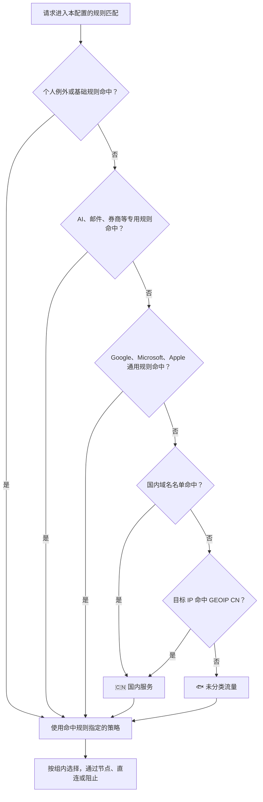

<div align="center">

# 🚀 ss-rules

**扫码导入 · 默认跟随首页 · 按服务独立选出口**

已有一条可用节点，就可以按默认方式开始使用；有地区需求，再调整对应服务。


**用 Shadowrocket 扫码，按提示导入配置。**

[📄 推荐配置](https://raw.githubusercontent.com/captainamari/ss-rules/main/Shadowrocket.conf) · [📦 完整备用版](https://raw.githubusercontent.com/captainamari/ss-rules/main/Shadowrocket-full.conf) · [🎛 选择出口](#routing)

</div>

## 📲 三步开始

需要已安装 Shadowrocket（小火箭），并准备好自己的节点或订阅。本配置负责分流，不提供节点。

1. **选好节点**：在首页导入自己的节点或订阅，选中一条可用节点。
2. **扫码导入**：扫描上方二维码，在「配置」页使用 `Shadowrocket.conf`，等待规则集加载完成，确认配置处于使用中（✔️）。
3. **开启连接**：首页「全局路由」选择「配置」，打开连接开关。

**默认无需逐个配置服务组，也不要求同时拥有香港、美国、日本和台湾节点。** 海外服务和未分类流量跟随首页节点；国内服务、普通 Apple 服务、香港银行及名单中的应用内 DNS 默认直连。某条节点能否访问某项服务，仍取决于节点及服务本身。

<details>
<summary>📋 同一台手机导入，或远程规则下载失败</summary>

复制下面的地址，打开 Shadowrocket →「配置」→ 右上角 `+` → 粘贴并下载，再选择「使用配置」：

```text
https://raw.githubusercontent.com/captainamari/ss-rules/main/Shadowrocket.conf
```

| 文件 | 使用方式 |
|---|---|
| `Shadowrocket.conf` | 小主配置，引用本仓库的远程规则集；二维码默认导入这一版 |
| `Shadowrocket-full.conf` | 完整单文件，所有规则内嵌；下载成功后无需另行下载规则集 |

两版采用相同的策略组和匹配顺序。远程规则加载失败时，先用可用节点恢复网络后重试，或导入上方链接中的完整备用版；两版不会自动互相切换。备用文件本身也需要先下载。

二维码使用 Shadowrocket 的配置导入协议；其他扫码工具没有唤起应用时，使用上述地址即可。

</details>

<a id="routing"></a>

## 🎛 找到服务，选择出口

在 Shadowrocket **首页下拉**，或点击节点列表上方的**指示牌图标**，进入「代理分组」。日常只需点选，不需要编辑配置文件。

| 我想…… | 这样选 |
|---|---|
| 📱 使用首页选中的节点 | **🚀 默认出口 → 📱 跟随首页**，初始就是此选项 |
| 📌 给大部分海外服务固定节点 | 在 **🚀 默认出口** 中直接选一条具体节点 |
| 🤖 ChatGPT 使用美国地区 | **🤖 ChatGPT → 🇺🇸 美国自动** |
| 📈 盈透固定一条香港线路 | 在 **📈 券商服务** 中直接选自己的具体香港节点 |
| 📮 邮件独立固定日本线路 | 在 **📮 邮件服务** 中直接选自己的具体日本节点 |
| 🎬 YouTube 自动选择香港线路 | **🎬 YouTube → 🇭🇰 香港自动** |
| 🐟 未匹配其他规则的请求走台湾 | **🐟 未分类流量 → 🇹🇼 台湾自动** |
| ↩️ 取消某个代理服务的单独选择 | 将该服务重新选为 **🚀 默认出口** |

**每个服务组中直接选择的节点相互独立。** 在券商组换线不会改变邮件组的选择；只有选择了「🚀 默认出口」的服务，才跟随默认出口一起变化。直连分类也不会因默认出口变化而自动改为代理。

地区自动组可能在同地区节点间换线。需要固定线路时，在服务组内直接选具体节点；不要把自动组中的临时点选当作固定选择。使用首页节点固定线路时，还应关闭首页的自动切换/回退；在分组中手动测速时，留意「测试并选择最快服务器」开关。

<details>
<summary>🧭 节点少、没有某个地区、节点名称看不懂</summary>

- **只有一条节点**：保持「🚀 默认出口 → 📱 跟随首页」，所有默认代理服务可共用它。
- **没有美国节点**：不要选择「🇺🇸 美国自动」。使用默认出口或直接选择已有节点；配置不会生成美国节点，也不保证该节点满足服务的地区要求。
- **节点不带地区名称**：仍可在各服务组直接点选；地区自动组依靠名称识别，无法自动归类这条节点。
- **名称是流量/到期提示**：这类信息条目会被筛除，不应当作节点选择。
- **选中的节点被订阅删除或改名**：在受影响的服务组重新选择；不要依赖客户端对失效选择的回退行为。

常见地区写法包括 `香港01` / `HK01` / `🇭🇰 01`、`美国01` / `US01` / `🇺🇸 01`，以及对应的日本、台湾名称。

名称是筛选线索，不是出口地理验证。`香港中转-美国01` 等混合名称可能进入多个地区组，应向节点提供者确认实际出口，直接选择已确认的节点。节点名称建议清楚标注出口地区。候选节点过多时，可在客户端代理分组编辑界面限定订阅范围。

</details>

<details>
<summary>🗺 分流示例：券商香港、AI 美国、邮件日本、未分类台湾</summary>

先确认自己拥有所需地区的可用节点，再在代理分组中依次选择：

| 策略组 | 选择 |
|---|---|
| 🚀 默认出口 | 其他代理服务使用的具体节点 |
| 📈 券商服务 | 自己的具体香港节点，例如「香港01」 |
| 🤖 ChatGPT、🧠 Claude、✨ Google AI | 各自选择「🇺🇸 美国自动」，或各自点选具体美国节点 |
| 🧩 其他 AI、🍎 Apple 智能 | 也需要美国时，分别选择美国自动或具体节点 |
| 📮 邮件服务 | 日本自动或具体日本节点 |
| 🐟 未分类流量 | 台湾自动或具体台湾节点 |

示例节点名称需要换成手机上真实存在的节点。首页也保留一条可用节点，供「📱 跟随首页」及使用默认节点的 DNS 查询使用。

其余原本跟随「🚀 默认出口」的服务无需再改。若也希望普通 Apple、香港银行、国内服务、应用内 DNS 走默认节点，需要分别将这些原本直连的组改为「🚀 默认出口」；局域网和旁路路由仍独立处理。

打开目标服务后，可在「数据 → 代理」启用并查看日志，确认实际命中的规则、策略和节点。配置内的「测试规则」可辅助检查域名匹配；它不代表整个 App 的所有连接。

</details>

## 🧭 请求怎样选择线路

**规则的顺序决定先匹配谁；代理分组的界面排列不决定匹配优先级。** 请求命中规则后，就使用该规则指定的策略，再按组内选择找到出口。

以下流程假设「全局路由」为「配置」、规则集已加载；不包含系统旁路和额外模块带来的优先级变化。



**未分类不是故障备用。** 已经命中 ChatGPT 的请求不会因为美国节点失败就继续匹配到台湾；没有命中域名规则、但命中 `GEOIP,CN` 的请求仍属于国内服务。

| 请求示例 | 命中的组 |
|---|---|
| `gemini.google.com`、`generativelanguage.googleapis.com` | ✨ Google AI，优先于 Google 通用规则 |
| `copilot.microsoft.com` | 🧩 其他 AI，优先于 Microsoft 通用规则 |
| `smtp.office365.com`、`outlook.office365.com`、`outlook.live.com`、`outlook.office.com`、`outlook.cloud.microsoft` | 📮 邮件服务 |
| `mail.google.com`、`gmail.googleapis.com`、`mail-attachment.googleusercontent.com` | 📮 邮件服务 |
| `accounts.google.com` | 🔎 Google，共享登录入口 |
| `login.microsoftonline.com` | 🪟 Microsoft，共享登录入口 |
| `deepseek.com`、`doubao.com`、`mail.qq.com`、`mail.163.com` | 🇨🇳 国内服务 |

<details>
<summary>🗂 查看完整分类顺序和默认出口</summary>

下表按当前配置的规则顺序排列；基础规则包括局域网、名单中的 HTTPDNS，以及提前处理的国内服务例外。

| 先后 | 分类 | 默认出口 |
|---|---|---|
| 1 | 个人直连例外、个人代理例外 | DIRECT / 🚀 默认出口 |
| 2 | 局域网、应用内 DNS、明确国内服务例外 | 直连 |
| 3 | 🤖 ChatGPT、🧠 Claude、✨ Google AI、🧩 其他 AI、🍎 Apple 智能 | 🚀 默认出口 |
| 4 | 🎬 YouTube、📮 邮件服务 | 🚀 默认出口 |
| 5 | 🏦 香港银行 | 🎯 直接连接 |
| 6 | 📈 券商服务、💻 开发服务、✈️ Telegram | 🚀 默认出口 |
| 7 | 🔎 Google、🪟 Microsoft、🔔 Apple 推送 | 🚀 默认出口 |
| 8 | 🍏 Apple 服务 | 🎯 直接连接 |
| 9 | 🇨🇳 国内域名名单、GEOIP CN | 🎯 直接连接 |
| 10 | 🐟 未分类流量（FINAL） | 🚀 默认出口 |

个人例外源名单默认留空。规则按照 [rules/order.json](rules/order.json) 生成；专用服务先于厂商通用分类。远程规则版和完整备用版来自同一条有序规则序列。

**分类针对请求，不是整个 App。** Gmail、Outlook 的专用网页和收发服务器归邮件；共享账户登录、公共 CDN、云盘等仍按各自规则处理。同一主机上的不同 HTTPS 路径不能通过本项目的域名规则区分。

iCloud 的 `mail.me.com` 收发服务器归邮件；`icloud.com/mail` 与其他 iCloud 服务共用主机，网页入口仍属于 Apple 服务。QQ、163 等国内邮箱维持国内分类。企业自建邮箱或未列出的邮件域名需要补充规则。

盈透的官网、Client Portal、IBKR 和 `ibllc.com` / `ibllc.com.cn` 网关域名归券商。若连接直接使用 IP、无法关联域名，应根据实际连接记录补充精确 IP 规则。

</details>

## 🔄 更新与个人设置

使用公共配置时，在「配置」页更新 `Shadowrocket.conf`，再「使用配置 / 编译配置」，确认规则集加载成功；完整备用版更新自身文件即可。节点订阅在首页单独更新。

**直接修改公共配置文件会在远程更新时被覆盖。** 经常需要固定不同服务出口时，可建立一个本地扩展配置保存个人组设置。具体步骤见 [保留个人设置与更新规则](docs/personal-settings.md)。完成更新后应确认当前使用的文件及各组选择，不依赖不同客户端版本对临时点选状态的保存行为。

<details>
<summary>🛠 维护者：新增服务、定制名单和生成配置</summary>

| 需求 | 修改位置 |
|---|---|
| 给已有服务补域名 | `rules/` 下的对应名单，例如 [盈透](rules/interactive-brokers.list)、[邮件](rules/mail-extra.list) |
| 新服务沿用现有分类 | 新建 `rules/new-service.list`，在 [rules/order.json](rules/order.json) 关联已有策略组 |
| 新服务需要独立选出口 | 再在 [config/base.conf](config/base.conf) 定义组，默认继承「🚀 默认出口」，并同步规则的策略名称 |
| 域名直连或走默认出口 | [personal-direct.list](rules/personal-direct.list) / [personal-proxy.list](rules/personal-proxy.list) |
| 默认出口、图标、地区筛选、DNS | [config/base.conf](config/base.conf) |

名单只写匹配条件，策略和顺序由 `rules/order.json` 指定：

```ini
DOMAIN,api.example.com
DOMAIN-SUFFIX,example.org
```

例如新增一家券商，只需添加其名单并关联「📈 券商服务」，不必新增组：

```json
{"path": "rules/new-broker.list", "policy": "📈 券商服务", "mode": "strict"}
```

将该条目放在券商分类区域，并位于可能覆盖它的厂商通用规则之前。`DOMAIN` 匹配完整主机名；`DOMAIN-SUFFIX` 匹配域名及子域名。只加入明确属于该服务的域名，避免把共享登录域名、整片 CDN 或所有邮件端口一起改道。不要将同一目标放入互相冲突的个人例外名单。

新增可独立选节点的服务组时，可复制现有服务组的 `select`、`policy-regex-filter` 等设置，保留默认出口作为初始选择。公共配置不写用户的订阅地址、凭据或具体节点名称。组名引用必须完全一致，包括 emoji。

修改源文件后，用 Python 3.10+ 生成：

```bash
python3 scripts/build.py
```

将修改的源文件、两种 `.conf` 和新生成的 `rulesets/` 一起提交。生成过程检查策略引用、组循环和名单格式，并将重复、跨分类覆盖情况记录到本地的 `.local/build-report.json`，维护者应检查相关分类是否符合预期。

远程名单按**各自内容**生成不可变地址 `rulesets/<来源>/<内容摘要>.list`。修改一个名单不会仅因整体版本或排列位置变化而改掉其他名单地址；若去重结果连带改变了其他名单，其地址也会相应变化。主配置保存每份名单的实际地址，客户端需要更新主配置才能引用新内容。

请编辑源文件后重新生成，不要直接改生成结果；已发布的旧名单保留，供尚未更新的客户端使用。规则源快照位于 `vendor/`，版本及校验值记录在 `sources.json`。

`config/base.conf` 的 `update-url` 决定发布地址；完整备用版自动使用同目录的 `Shadowrocket-full.conf`。Fork 后先修改这个地址，再生成。

</details>

<details>
<summary>⚙️ 网络选项与排查</summary>

- **没有对应节点**：使用默认出口或直接选择节点；地区组不会自动借用其他国家的线路。
- **测速正常但服务打不开**：测速检查的是探测地址，不代表具体服务可用。查看连接记录，确认命中组、实际节点及请求失败原因。
- **DNS**：直连域名规则使用系统 DNS。需要使用覆写 DNS 的查询通过配置的 DoH 处理，`#proxy` 指首页默认节点，不是「🚀 默认出口」或各服务组选中的节点。代理连接还可能由远端解析域名，不能把所有代理域名都理解成先经过本机 DoH。
- **IPv6 / UDP**：配置关闭 IPv6 支持与 IPv6 优先选项，但这不等于在操作系统层面禁用一切 IPv6 连接。QUIC 允许；节点不支持 UDP 转发时拒绝对应 UDP 流量。语音、通话等还需要节点本身支持相应协议。
- **局域网**：`skip-proxy` 指定交给 TUN 接口处理，不等同于直连开关；实际旁路和直连还由路由、局域网规则决定。
- **额外模块与模式**：模块可引入更高优先级规则；「全局路由」设为「代理」时不会按本配置进行服务分流。

</details>

## 📚 来源与许可

规则来源：[LingJingMaster/Shadowrocket-Rules](https://github.com/LingJingMaster/Shadowrocket-Rules)、[blackmatrix7/ios_rule_script](https://github.com/blackmatrix7/ios_rule_script)。客户端操作参考：[Shadowrocket 社区使用手册](https://github.com/LOWERTOP/Shadowrocket)。邮件补充名单中的注释链接到服务提供方说明。

许可与署名见 [NOTICE.md](NOTICE.md)、[LICENSE](LICENSE) 和 [MIT 声明](LICENSES/LingJingMaster-MIT.txt)。
